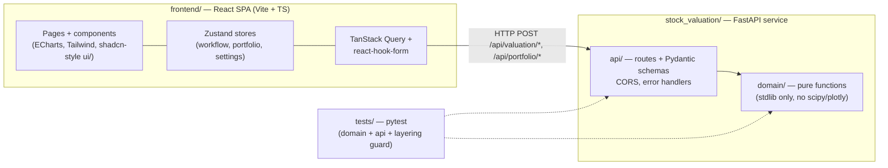
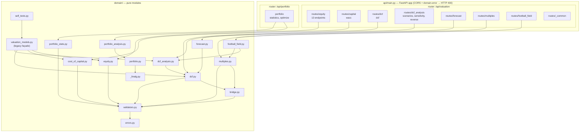
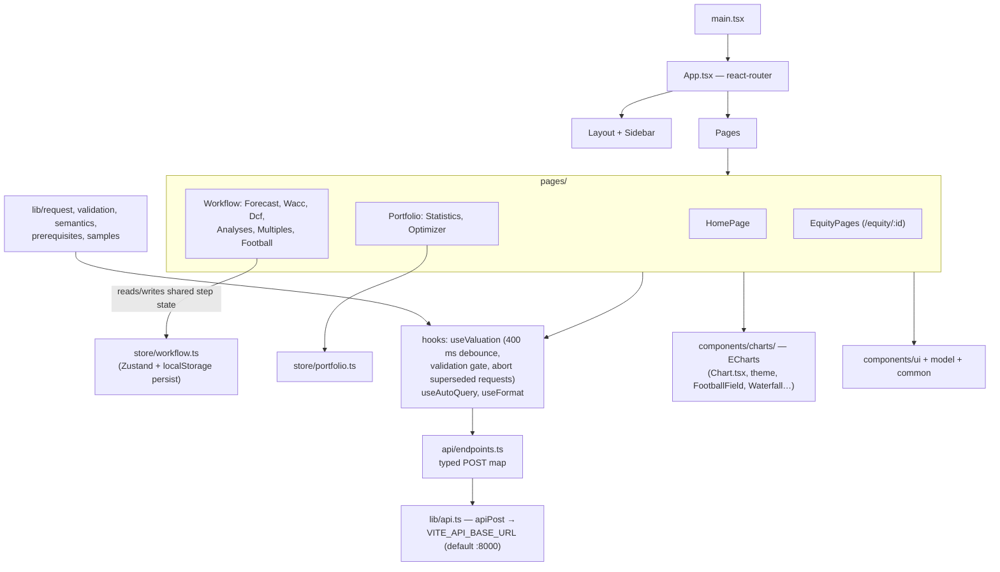
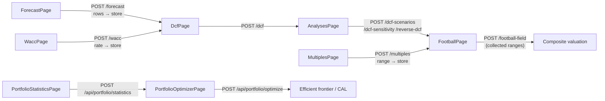

# Architecture Map

Mermaid maps of the codebase, generated from actual imports in the source.

## 1. System overview

Two-tier app: a React SPA talks to a FastAPI service whose routes wrap pure-Python domain functions.

## 2. Backend layering (`stock_valuation/`)

`stock_valuation/api/main.py` mounts two routers; every route module delegates to one domain module. The domain is a strict DAG — `tests/domain/test_layering.py` enforces the import direction.

## 3. Frontend architecture (`frontend/src/`)

## 4. Page → endpoint flow (the student workflow)

## Key takeaways

- The backend keeps a hard three-layer contract: routes → schemas → pure domain, with stdlib-only math in `stock_valuation/domain/_linalg.py`.
- The frontend centralizes all backend access in `frontend/src/api/endpoints.ts`; request/response types are generated from the OpenAPI schema (`frontend/src/api/schema.d.ts`).
- `frontend/src/store/workflow.ts` is the pipeline memory that chains Forecast → WACC → DCF → Analyses → Football Field, persisted to localStorage.
